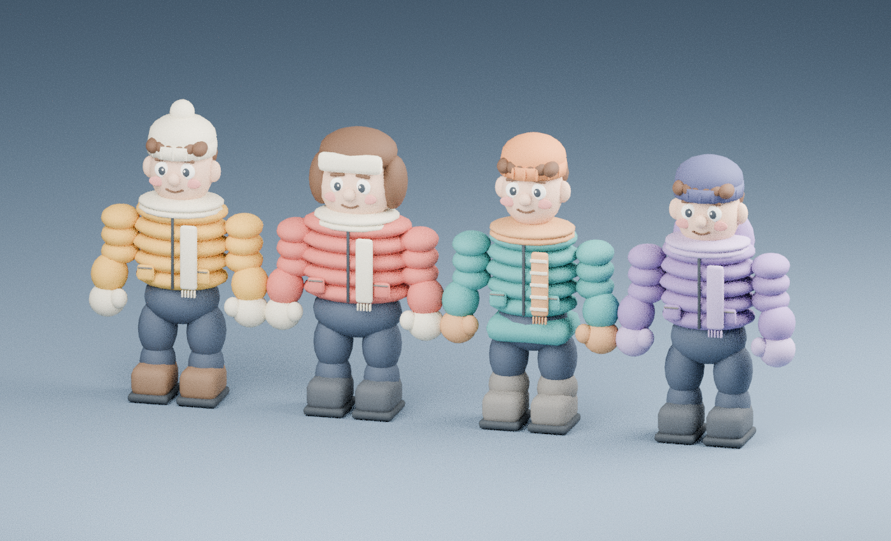

# 3D-персонажи «Зимнего двора»



Это реальные объёмные модели, созданные в Blender 4.3.2, а не изображения на плоскости. Стиль — упрощённые мультяшные персонажи по мотивам иллюстрации. Детализация концепта (реалистичные ткани/лица) не воспроизводится один к одному.

| Персонаж | FBX | GLB | Треугольники |
|---|---|---|---|
| Игрок, жёлтая куртка и помпон | [Player.fbx](Player.fbx) | [Player.glb](Player.glb) | 22 128 |
| Мишка, красная куртка и ушанка | [Mishka.fbx](Mishka.fbx) | [Mishka.glb](Mishka.glb) | 17 856 |
| Санёк, бирюзовая парка и рыжая шапка | [Sanyok.fbx](Sanyok.fbx) | [Sanyok.glb](Sanyok.glb) | 22 416 |
| Димон, фиолетовая куртка и капюшон | [Dimon.fbx](Dimon.fbx) | [Dimon.glb](Dimon.glb) | 22 128 |

**Исходник:** [WinterYard-Characters.blend](WinterYard-Characters.blend), четыре персонажа и сцена превью. У каждого 11 суставов B00–B10 и жёсткие веса по сегментам. Это простой сегментный скелет, не готовый Unity Humanoid/пакет Mixamo. Клипы анимации в FBX/GLB не запечены; в игре остаются процедурные анимации CharacterRig и CharacterJoint-ragdoll. Материалы цветовые PBR, без рисованных текстур и общего UV-атласа. Число треугольников относится к экспортируемой геометрии, не к физическим коллайдерам.

## Как используются в игре

Геометрия автоматически загружается из `Unity/Assets/KingOfTheHill/Resources/Characters/*.json` через CharacterModel и крепится к 11 сегментам CharacterRig. Старые примитивные визуальные элементы скрываются; существующие физические коллайдеры, движения, атаки и ragdoll сохраняются. При отсутствии модели используется старый вид с предупреждением. Вручную переносить FBX в Inspector не нужно. FBX/GLB лежат вне Assets для редактирования/передачи и не импортируются Unity повторно.

Пропорции моделей различаются визуально, а базовые характеристики участников и коллайдеры остаются прежними. Сгенерированные материалы и меши очищаются при удалении персонажа. Начало координат экспортируемого персонажа соответствует центру игровой капсулы, а не подошвам.

## Воспроизведение и проверка

```bash
blender --background --python tools/build_character_models.py -- /absolute/path/to/MyGame
python tools/validate_character_models.py
```

Первая команда пересоздаёт модели, экспорты и превью. Генерация и рендер выполнены в Blender; проверены индексы/нормали геометрии, FBX/GLB-заголовки и 11 skin-joints в каждом GLB. Проверена загрузка исходной сцены Blender. В Unity Editor эти модели ещё не запускались. Нужна проверка внешнего вида, анимаций швов, соответствия коллайдерам и ragdoll после импорта проекта. Скелет состоит из жёстко привязанных сегментов: при экстремальных позах возможны видимые стыки. LOD, единый атлас, полноценные деформируемые Humanoid-скины и оптимизация материалов — следующие этапы.
