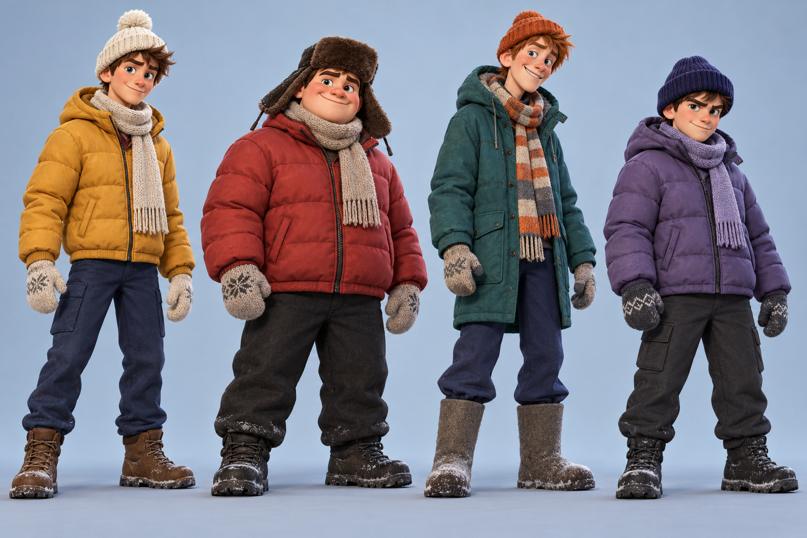

# Персонажи «Зимнего двора»

Слева направо:

- **Игрок:** горчичная куртка, светлая шапка с помпоном, светлый шарф.
- **Мишка:** широкая фигура, красная куртка, меховая ушанка.
- **Санёк:** высокий силуэт, бирюзовая парка, рыжая шапка, полосатый шарф.
- **Димон:** компактный силуэт, фиолетовая куртка, тёмная шапка.

Иллюстрация сгенерирована как визуальный референс для игры. Она не является 3D-моделью, текстурным атласом, скелетом или анимацией. По мотивам этих образов теперь созданы отдельные 3D-модели с простым сегментным скелетом: [FBX, GLB, Blender и превью](../Models/Characters/README.md). Они автоматически подключены к игровому CharacterRig. Стиль моделей упрощён по сравнению с иллюстрацией; полноценные рисованные текстуры и Humanoid-скин остаются следующим этапом.
